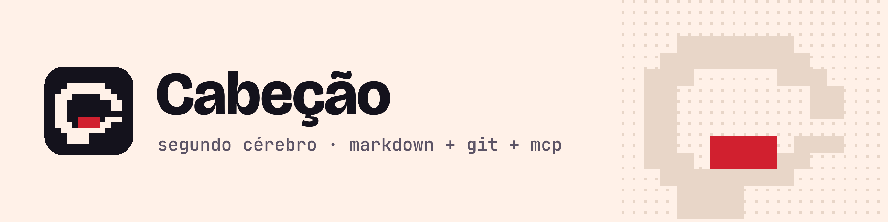

<p align="center">
  <picture>
    <source media="(prefers-color-scheme: dark)" srcset="assets/marca/banner-escuro.png">
    
  </picture>
</p>

<p align="center">
  Your second brain in Markdown and git, for you and your AI agents, served over MCP.
</p>

<p align="center">
  <a href="https://www.npmjs.com/package/cabecao"></a>
  <a href="https://github.com/renanloureiroo/cabecao/actions/workflows/ci.yml"></a>
  <a href="LICENSE"></a>
  <a href="https://nodejs.org"></a>
</p>

<!-- README-I18N:START -->

[Português](./README.md) | **English**

<!-- README-I18N:END -->

Your notes are Markdown files in a git repository you own, on any host. AI agents (Claude Code, Codex, Cursor and others) read and write them over MCP, and every write becomes a commit you can undo with one command. The name is a tribute to Cabeção from *Malhação*.

> **Beta.** The current version is `0.1.0-beta.1`. It works day to day, but commands and formats may still change before 1.0. The CLI prints its messages in Portuguese for now; the MCP tools that agents use are described in English.

## What it looks like

```text
$ cabecao init git@github.com:voce/cerebro.git
Pronto. Seu cérebro está em ~/cabecao (máquina notebook) e em git@github.com:voce/cerebro.git.

Repositório vazio: estrutura do cérebro criada na branch main e enviada para git@github.com:voce/cerebro.git.
Índice local: 0 notas indexadas em 2 ms.

Agentes:
  Codex   servidor MCP registrado em ~/.codex/config.toml
  Cursor  servidor MCP registrado em ~/.cursor/mcp.json
  Reinicie os agentes que estiverem abertos para eles enxergarem o Cabeção.

Teste agora:
  1. No Codex, peça: "guarde que eu prefiro respostas curtas, em tópicos"
  2. Numa conversa nova, pergunte: "como eu prefiro as respostas?"
  3. Ou confira aqui: cabecao search "respostas curtas"

Opcional (rode quando quiser):
  cabecao install-skills  ensina Codex e Cursor a usar o cérebro pela linha de
                          comando (skills)
  ...
```

In a Claude Code session you say "remember that the payment tests only pass with `TZ=UTC`", and the agent calls the `remember` tool:

```json
{
  "op": "01M79DRQR9648E1JZ60MF0EBNN",
  "path": "memory/gotchas/testes-de-pagamento-precisam-do-fuso-fixo.md",
  "action": "add",
  "commit": "1af64e1dc48f5627dd086474c571b22326eaa3c0"
}
```

The note is a plain `.md` file. In the next session, on any machine, it comes back in the agent's `recall`. And from the terminal:

```text
$ cabecao search "testes pagamento"
1 resultado(s) para "testes pagamento", com todos os termos (validade em 2026-11-13):

1. Testes de pagamento precisam do fuso fixo  [gotcha · project:pagamentos]  vigente
   memory/gotchas/testes-de-pagamento-precisam-do-fuso-fixo.md
   Os «testes» do serviço de pagamentos falham perto da meia-noite se o fuso não for fixo. Rode com `TZ=UTC npm test`.
```

## Why

- **Your data, in your format.** Markdown in a git repository you control. It opens in Obsidian or any editor, and stays yours if you stop using Cabeção.
- **Any host.** GitHub, GitLab, Bitbucket, Gitea, your own server, or just your machine. Only git, no provider API.
- **Memory across sessions and machines.** What you teach in one conversation comes back in the next, in any MCP client.
- **Everything is reversible.** Every write is an identified commit; `cabecao undo` reverts one operation or a whole agent session.
- **Agents with limits.** Rules and instruction files only change with your explicit, confirmed request; secrets never get in; and every agent commit carries its mark.
- **Maintenance with nobody watching.** `cabecao consolidate --run` calls Claude Code or Codex to consolidate the memory, with only Cabeção's tools, and undoes whatever is left half done.

## Install

Requires Node.js 22.16+ (24 recommended) and git 2.38+. Create an **empty, private** repository first.

```bash
npm i -g cabecao@beta
cabecao init git@github.com:voce/cerebro.git
cabecao doctor
```

`init` ends with what to ask the agent to test and the optional next steps it detected. It also adopts an Obsidian vault that is in a git repository (cloned into a new folder, without moving or renaming notes), and without a URL it creates a local-only brain.

## Connect the agents

`init` already registers the MCP server in the clients it finds: Claude Code, Claude Desktop, Codex, Cursor, VS Code, Antigravity and Gemini CLI. To register later, `cabecao install-client --all`.

In agents with a shell, the Cabeção **skills** teach the agent to use the brain through the command line, without the MCP server and under the same rules:

```bash
cabecao install-skills
```

In Claude Code, the plugin brings everything together (bundled server, briefing at session start, sync at the end, and the skills): `/plugin marketplace add renanloureiroo/cabecao` and `/plugin install cabecao@cabecao`.

## Features

- `init` on any git remote, adopting Obsidian vaults, with an ending that leads to the first test
- `sync` that never loses data: a conflict copy instead of an overwrite; automatic sync with `schedule`
- Keyword search and, optionally, search by meaning with a local model; validity over time (`--as-of`)
- Graph: wikilinks, typed relations, facts and unlinked mentions
- MCP server with 17 tools, Claude Code plugin, Claude Desktop `.mcpb` package and skills for agents with a shell
- Memory with a lifecycle: handoff, resolved duplicates, `lint`, `consolidate` (also with an agent on its own), `forget`
- `undo` per operation or session; secret scanner; rules only with your explicit request
- Obsidian with one command (`obsidian setup`); `upgrade` and `uninstall`

What comes next is in [Coming soon](https://renanloureiroo.github.io/cabecao/en/em-breve).

## Documentation

Everything is on the site: **[renanloureiroo.github.io/cabecao/en](https://renanloureiroo.github.io/cabecao/en/)**, in English and Portuguese. Quick start, concepts, guides (Obsidian, conflicts, undo, rules), CLI and MCP tool reference, security and troubleshooting.

## Contributing

Issues and pull requests are welcome. Read [CONTRIBUTING.md](CONTRIBUTING.md) (in Portuguese) for how to run the project and the conventions. To report a vulnerability, use GitHub's private vulnerability reporting.

## License

[MIT](LICENSE) © Renan Pereira Loureiro
