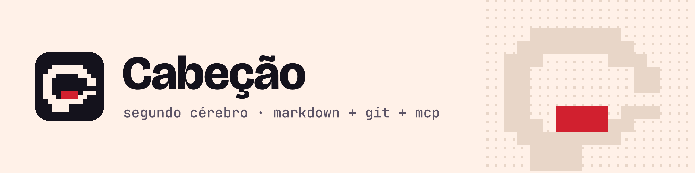

<p align="center">
  <picture>
    <source media="(prefers-color-scheme: dark)" srcset="assets/marca/banner-escuro.png">
    
  </picture>
</p>

<p align="center">
  Seu segundo cérebro em Markdown e git, para você e seus agentes de IA, servido por MCP.
</p>

<p align="center">
  <a href="https://www.npmjs.com/package/cabecao"></a>
  <a href="https://github.com/renanloureiroo/cabecao/actions/workflows/ci.yml"></a>
  <a href="LICENSE"></a>
  <a href="https://nodejs.org"></a>
</p>

<!-- README-I18N:START -->

**Português** | [English](./README.en.md)

<!-- README-I18N:END -->

Suas notas são arquivos Markdown num repositório git seu, em qualquer provedor. Os agentes de IA (Claude Code, Codex, Cursor e outros) consultam e gravam nelas por MCP, e cada gravação vira um commit que você desfaz com um comando. O nome homenageia o Cabeção de *Malhação*.

> **Beta.** A versão atual é a `0.1.0-beta.1`. Já funciona no dia a dia, mas comandos e formatos ainda podem mudar antes da 1.0.

## Como é

```text
$ cabecao init git@github.com:voce/cerebro.git
Pasta do cérebro: ~/cabecao (máquina notebook)

Repositório: Repositório vazio: estrutura do cérebro criada na branch main e enviada para git@github.com:voce/cerebro.git.

Índice local: 0 notas indexadas em 2 ms.

Clientes de IA:
  Claude Code: registrado
    ~/.claude.json: registrado
  Reinicie o cliente para ele enxergar a mudança.
...
  14 ok, 0 avisos, 0 falhas.
```

Numa sessão do Claude Code, você pede "guarde que os testes de pagamento só passam com `TZ=UTC`", e o agente chama a tool `remember`:

```json
{
  "op": "01M79DRQR9648E1JZ60MF0EBNN",
  "path": "memory/gotchas/testes-de-pagamento-precisam-do-fuso-fixo.md",
  "action": "add",
  "commit": "1af64e1dc48f5627dd086474c571b22326eaa3c0"
}
```

A nota é um arquivo `.md` comum. Na próxima sessão, em qualquer máquina, ela volta no `recall` do agente. E também pelo terminal:

```text
$ cabecao search "testes pagamento"
1 resultado(s) para "testes pagamento", com todos os termos (validade em 2026-11-13):

1. Testes de pagamento precisam do fuso fixo  [gotcha · project:pagamentos]  vigente
   memory/gotchas/testes-de-pagamento-precisam-do-fuso-fixo.md
   Os «testes» do serviço de pagamentos falham perto da meia-noite se o fuso não for fixo. Rode com `TZ=UTC npm test`.
```

## Por quê

- **Seus dados, num formato seu.** Markdown num repositório git que você controla. Abre no Obsidian, em qualquer editor, e continua seu se você parar de usar o Cabeção.
- **Qualquer provedor.** GitHub, GitLab, Bitbucket, Gitea, um servidor seu ou só a sua máquina. Só git, sem API de provedor.
- **Memória entre sessões e máquinas.** O que você ensina numa conversa volta na próxima, em qualquer cliente MCP.
- **Tudo reversível.** Cada gravação é um commit identificado; `cabecao undo` desfaz uma operação ou uma sessão inteira de um agente.
- **Agentes com limites.** Eles não criam regras, não editam arquivos de instrução, não gravam segredos e deixam rastro quando mexem numa nota sua.

## Instalação

Requer Node.js 22.16+ (recomendado: 24) e git 2.38+. Crie antes um repositório **vazio e privado**.

```bash
npm i -g cabecao@beta
cabecao init git@github.com:voce/cerebro.git
cabecao doctor
```

O `init` também adota um vault do Obsidian que já existe, sem mover arquivos, e sem URL cria um cérebro só local.

## Conectar ao Claude Code

O `init` já registra o servidor MCP nos clientes que encontrar. Para registrar depois:

```bash
cabecao install-client claude-code
```

Reinicie o Claude Code. Também funciona com Claude Desktop, Codex, Cursor, VS Code e Gemini CLI (`cabecao install-client --all`).

## Recursos

| Hoje (`0.1.0-beta.1`) | Em breve |
| --- | --- |
| `init` em qualquer remoto git, com adoção de vault do Obsidian | Busca por significado, com modelo local |
| `sync` sem perder nada: cópia de conflito em vez de sobrescrever | Plugin do Claude Code com hooks |
| Busca por palavra-chave com validade no tempo (`--as-of`) | Revisão, consolidação e "esquecer" memórias |
| Grafo: wikilinks, relações tipadas, fatos e menções sem link | Integração com o Obsidian |
| Servidor MCP com 12 tools e restrições a agentes | Pacote para o Claude Desktop |
| | Respostas com citações conferidas (`ask`), opcionais, com o provedor que você escolher |
| `undo` por operação ou sessão; scanner de segredos | |

## Documentação

Tudo está no site: **[renanloureiroo.github.io/cabecao](https://renanloureiroo.github.io/cabecao/)**, em português e em inglês. Começo rápido, conceitos, guias (Obsidian, conflitos, desfazer, regras), referência da CLI e das tools MCP, segurança e solução de problemas.

## Contribuir

Issues e pull requests são bem-vindos. Leia o [CONTRIBUTING.md](CONTRIBUTING.md) para rodar o projeto e as convenções. Para relatar uma vulnerabilidade, use o relato privado de vulnerabilidades do GitHub.

## Licença

[MIT](LICENSE) © Renan Pereira Loureiro
