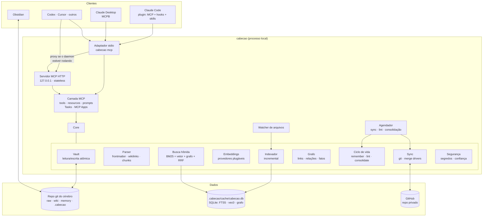
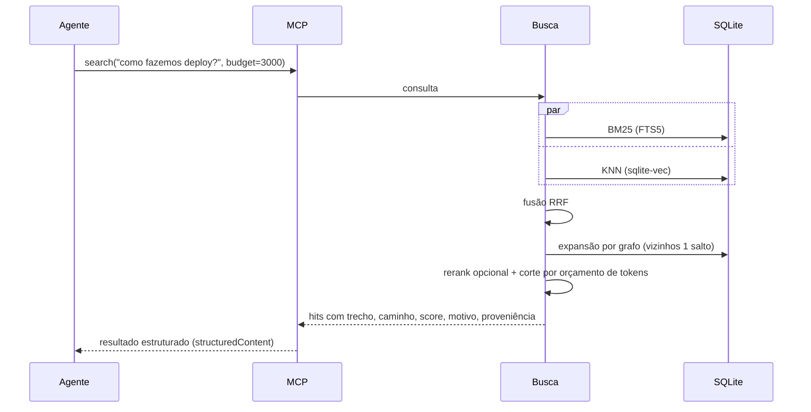

# 02 · Arquitetura

## Visão de componentes



## Processos

O Cabeção roda em **dois modos**, sempre com um **único escritor** por cérebro:

| Modo | Como inicia | Quando usar |
|---|---|---|
| **Daemon** (`cabecao serve`) | Serviço do sistema (launchd/systemd/Task Scheduler) ou manual | Recomendado. Um processo só cuida do watcher, do indexador, da fila de embeddings, do sync agendado e do MCP via HTTP local |
| **Embutido** (`cabecao mcp`) | O cliente MCP inicia via stdio | Sem daemon; é o modo das primeiras versões. O adaptador roda o core no próprio processo. O SQLite em modo WAL aceita vários processos; um *lock* de arquivo serializa as operações de git. Não há watcher nem sync agendado: a indexação acontece ao iniciar e a cada escrita, e o sync é sob demanda |

O **adaptador stdio** (`cabecao mcp`) é a porta de entrada universal. Se o daemon está rodando, ele **repassa** as chamadas para o HTTP local. Senão, roda o core embutido. Assim, Claude Code e Claude Desktop abertos ao mesmo tempo **não brigam** pelo SQLite nem pelo git.

> A especificação MCP 2026-07-28 tornou o protocolo *stateless* (sem sessão de transporte). Isso facilita servir vários clientes num único daemon HTTP local. Ver [ADR-0006](adr/0006-mcp-2026-07-28-stateless.md).

## Fluxos principais

### 1. Busca (`search` / `recall`)


### 2. Escrita de memória (`remember`)
1. Valida o schema (tipo, escopo, fonte).
2. Roda o scanner de segredos e **rejeita** se encontrar algo.
3. Procura memórias parecidas (vetor + chave).
4. Decide **ADD / UPDATE / SUPERSEDE / NOOP**. Em caso ambíguo, devolve os candidatos para o **agente** decidir.
5. Escreve o Markdown de forma atômica (arquivo temporário + rename).
6. Indexa incrementalmente e enfileira o commit.

### 3. Ingestão (`ingest`)
1. Registra a fonte em `raw/` (cópia imutável + hash + metadados).
2. Devolve ao agente a fonte, o schema e as páginas relacionadas já existentes.
3. O **agente** escreve os resumos, conceitos e entidades (com `write_page`/`remember`).
4. O Cabeção atualiza `index.md`, `log.md`, os índices e o grafo.

### 4. Sincronização (`sync`)
Ver [04 · Sincronização](04-sincronizacao.md).

### 5. Consolidação (`consolidate`)
O servidor não tem LLM próprio (ver [05](05-mcp.md)), então quem raciocina é sempre um agente:
1. `consolidate(start)` cria a **branch** `cabecao/consolidation-AAAA-WW` e devolve os episódios recentes, o resultado do lint e os candidatos.
2. O **agente** analisa e grava as propostas com as tools de escrita.
3. `consolidate(finish)` faz o commit e abre um **PR** no GitHub (ou gera um relatório local, sem GitHub).
4. Você revisa e faz o merge.

Disparo: manual (você pede ao agente) ou agendado, quando a CLI chama um agente em modo não interativo (ex.: `claude -p`). Sem nenhum agente de linha de comando instalado, só o disparo manual funciona.

## Estrutura do repositório do projeto

```
cabecao/
├── packages/
│   ├── core/          # vault, parser, índice, busca, grafo, sync, ciclo de vida
│   ├── server/        # MCP: stdio + HTTP, tools, resources, prompts, extensões
│   ├── cli/           # CLI `cabecao` (publicado no npm como `cabecao`)
│   └── graph-app/     # MCP App: explorador visual do grafo
├── integrations/
│   ├── claude-code/   # plugin: .mcp.json, hooks, skills
│   ├── mcpb/          # manifest.json para o Claude Desktop
│   └── obsidian/      # graph.json, Bases, templates, Web Clipper
├── templates/vault/   # estrutura inicial do cérebro + schema
├── docs/              # esta documentação
└── .claude-plugin/    # marketplace.json (instalação via /plugin)
```

## Stack

| Camada | Escolha | Motivo |
|---|---|---|
| Linguagem | TypeScript, Node.js ≥ 22 | Ecossistema MCP de primeira linha; `npx` facilita a instalação |
| MCP | `@modelcontextprotocol/server` v2 | Tier 1, suporta 2026-07-28 com fallback 2025 |
| Banco local | SQLite (`better-sqlite3`) + FTS5 + `sqlite-vec` | Arquivo único, rápido, sem servidor |
| Embeddings | `transformers.js` (padrão, local) · Ollama · APIs | Zero dependência externa por padrão |
| Markdown | `remark`/`unified` + `gray-matter` | Parser robusto de frontmatter e wikilinks |
| Watcher | `chokidar` | Multiplataforma |
| Git | CLI `git` + `gh` (opcional) | Usa a instalação do usuário e as credenciais dele |
| Validação | Zod v4 | Schemas compartilhados entre MCP e core |
| Testes | Vitest + vault de *fixtures* + cliente MCP real (as duas gerações do protocolo) | |
| Monorepo | pnpm workspaces | |
