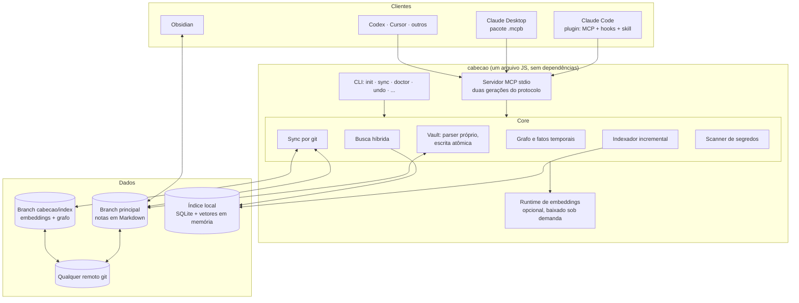

# 02 · Arquitetura

## Componentes



## Processos: sem daemon

Não existe serviço rodando o tempo todo. Cada processo é autossuficiente:

| Processo | Quem inicia | O que faz |
|---|---|---|
| `cabecao mcp` | O cliente MCP, um por cliente aberto | Atende as tools. Ao subir, **não faz nada com efeito colateral**; a varredura incremental roda na primeira chamada |
| `cabecao sync` | Hook de fim de sessão, agendador do sistema, você ou a tool `sync` | Sincroniza e sai. Roda como processo filho, separado do servidor |
| `cabecao serve` | Você, opcionalmente | Expõe o mesmo servidor por HTTP em `127.0.0.1`, com token |

Vários processos convivem na mesma máquina: o SQLite em modo WAL aceita escritores simultâneos, e um arquivo de trava serializa as operações de git. Testado com 8 processos, 880 escritas e 36 syncs, sem corrupção.

Arquivos alterados fora do Cabeção (você editando no Obsidian) são detectados por uma **varredura incremental** de data e tamanho, que leva menos de 1 segundo em 30 mil notas. O aviso de alteração do sistema operacional serve só de gatilho para essa varredura, porque sozinho ele perde eventos no Windows.

## Escolhas técnicas

Todas vêm de medição; os números estão em [11 · Evidências](11-evidencias.md).

| Camada | Escolha | Alternativa descartada |
|---|---|---|
| Linguagem | TypeScript estrito | — |
| Runtime | Node.js `^22.16 \|\| >=24` | Versões anteriores não têm busca por texto no SQLite embutido |
| Banco local | `node:sqlite` embutido, com FTS5 | `better-sqlite3` fica como plano B, por ser dependência nativa |
| Busca vetorial | Força bruta em JavaScript sobre `Int8Array` | `sqlite-vec`: mesma velocidade, sem binário para Windows ARM |
| Embeddings | EmbeddingGemma 300m (ONNX q4) com `onnxruntime-node` | Modelos menores erram demais em português; `transformers.js` pesa 470 MB |
| Parser de Markdown | Próprio (varredura de linhas + `yaml`) | `remark`: 12 vezes mais lento e errou mais casos |
| Grafo | Tabelas no SQLite + consultas recursivas | Banco de grafos, PageRank, detecção de comunidades |
| MCP | SDK oficial v2 (`@modelcontextprotocol/server` 2.4) + Zod 4 | SDK v1: clientes novos falham contra ele |
| Git | CLI `git` ≥ 2.38 do usuário | `gh` e APIs de provedor |
| Empacotamento | Um arquivo gerado por `tsdown`, sem dependências de runtime | Dependências normais: `npx` até 2 vezes mais lento |
| Projeto | pnpm, Vitest, Biome, Changesets | — |

## Estrutura do repositório do projeto

```
cabecao/
├── packages/
│   ├── core/            # vault, parser, índice, busca, grafo, sync, segurança
│   ├── server/          # servidor MCP
│   ├── cli/             # comando `cabecao` (publicado no npm)
│   └── embeddings/      # runtime opcional, instalado no diretório de dados do usuário
├── integrations/
│   ├── claude-code/     # plugin com o servidor embutido, hooks e skill
│   ├── mcpb/            # manifesto para o Claude Desktop
│   └── obsidian/        # grafo, painéis, tipos de propriedade, Web Clipper
├── templates/vault/     # estrutura inicial do cérebro
├── spikes/              # relatórios das provas de conceito
└── docs/
```

## Fluxos principais

### Escrita (`remember`, `write_page`)
1. Valida o esquema da nota.
2. Passa o conteúdo pelo scanner de segredos; se achar, recusa.
3. Procura memórias parecidas e decide: criar, atualizar, substituir ou ignorar. Em caso ambíguo, devolve os candidatos para o agente decidir.
4. Grava o arquivo de forma atômica (arquivo temporário + renomear).
5. Atualiza o índice local e faz um commit local no [padrão do projeto](12-commits.md).

### Busca (`search`, `recall`)
Ver [06 · Busca e grafo](06-busca-e-grafo.md).

### Sincronização
Ver [04 · Sincronização](04-sincronizacao.md).

### Onde o agente recebe as regras
A medição mostrou que só expor as tools não basta: sem instrução, o agente consultou o cérebro em 1 de 5 sessões. Com as regras no hook de início de sessão ou nas instruções do servidor, em 5 de 5. Por isso as regras de uso vão nos dois lugares; ver [05](05-mcp.md) e [07](07-ciclo-de-vida-e-seguranca.md).
