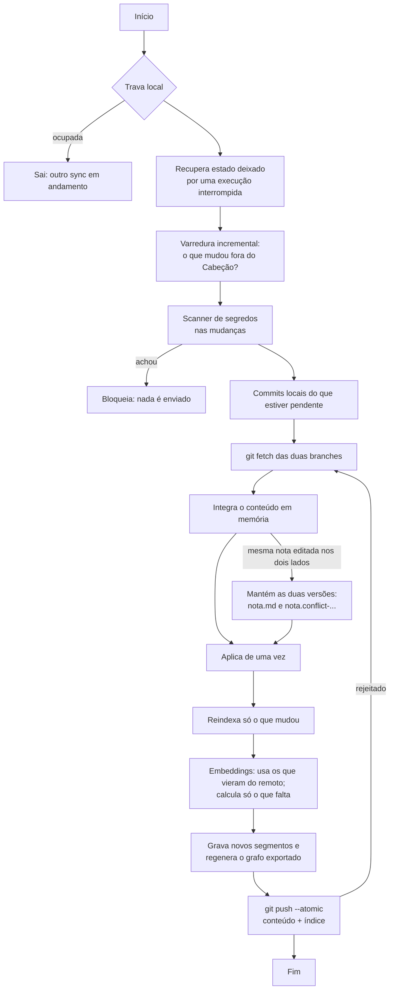

# 04 · Sincronização

> **Requisito:** nada é descartado. Conteúdo, embeddings e grafo sincronizam por git com **qualquer remoto**, e uma máquina nunca recalcula o que outra já calculou.

> **Estado (marco 1):** o sync de conteúdo da branch principal está implementado. A branch `cabecao/index`, os embeddings, o grafo exportado, o `compact` e as gerações são do **marco 2** e aparecem aqui como plano, marcados na coluna "Marco". Nada do que é do marco 2 existe no código hoje.

O desenho abaixo passou em 170 de 170 verificações, em 13 cenários, contra um remoto simulado em pasta local. Provedores reais ainda não foram testados; ver "O que falta validar".

## O que é sincronizado e como

**Regra (decisão do dono do projeto, [ADR 35](adr/README.md)): o sync leva tudo o que o git não ignora**, e não só as pastas de notas. Ficam de fora apenas:

- o que o `.gitignore` exclui;
- `.git/` e `.cabecao/`;
- os temporários da escrita atômica (`.cabecao-*.tmp`).

| Dado | Onde fica | Como sincroniza | Marco |
|---|---|---|---|
| Notas (`raw/`, `wiki/`, `memory/`) e anexos | Branch principal | git comum | 1 |
| Arquivos de configuração e de instrução: `.cabecao.json`, `CLAUDE.md`, `AGENTS.md`, `.gitignore`, `.gitattributes`, `dashboards/` | Branch principal | git comum. Conflito em qualquer um deles preserva as duas versões | 1 |
| `.obsidian/`, quando você a versiona | Branch principal | git comum. O modelo de `.gitignore` do `init` já exclui `workspace.json` e `workspace-mobile.json` | 1 |
| `log.md` | Branch principal | git, com merge por união (`.gitattributes`) | 1 |
| `index.md` | Branch principal | Regenerado depois de integrar; converge sozinho. É a única coisa que o sync escreve por conta própria | 1 |
| Conhecimento escrito pelo agente (relações, fatos, resumos) | Branch principal, dentro das notas | git comum | 1 (as tools de relações e fatos vêm no 3) |
| Banco de consulta (SQLite) | `.cabecao/cabecao.db`, local | Não vai para o git; é montado em segundos a partir do resto | 1 |
| Embeddings | Branch `cabecao/index`, em segmentos imutáveis | git, sem conflito por construção | 2 |
| Grafo exportado (`nodes.jsonl`, `edges.jsonl`) | Branch `cabecao/index` | Regenerado depois de integrar; idêntico byte a byte em todas as máquinas | 2 |

O sync não reescreve nem reformata arquivo de configuração: só o altera quando é necessário, e a única coisa que ele regenera é o `index.md`. Hoje o sync trabalha **só na branch principal**.

## Decisões que vieram dos testes

As duas últimas linhas descrevem o desenho do marco 2; as duas primeiras valem para o que já existe.

| Decisão | Motivo medido |
|---|---|
| A branch de índice é lida e escrita direto no banco de objetos do git, **sem** `git worktree` | O worktree quebrava ao mover o vault, ao apagar `.cabecao/` e em clones parciais |
| A integração é calculada em memória (`git merge-tree --write-tree`) e aplicada de uma vez (`git reset --keep`) | Não existe rebase "pela metade" para sobrar se o processo morrer |
| Conteúdo e índice sobem no **mesmo** `git push --atomic` | Enviando separado, um teste de carga calculou 2.789 embeddings para 1.477 trechos. Com envio único: 1.536 para 1.535 |
| O histórico do índice é reduzido por **gerações** (`cabecao/index` → `cabecao/index-1` → ...), sem reescrever histórico | Funciona em servidor que proíbe reescrita e exclusão de branch |

## O algoritmo de `cabecao sync`

No marco 1 o algoritmo vale para a branch principal. Os passos de embeddings, de segmentos e do grafo (`E`, `G` e a segunda branch no `fetch` e no `push`) são do marco 2.



Antes de todo envio, o scanner de segredos examina o que vai sair. Arquivos grandes são escaneados em pedaços, e um arquivo ilegível bloqueia o sync (nada é enviado).

### Tempos medidos (remoto local, sem rede)

Prova de conceito, com o desenho completo (duas branches e embeddings):
- Nada mudou: 0,5 a 0,7 s.
- Cinco notas alteradas: 1,1 a 1,8 s, mais o cálculo dos embeddings novos.

Implementação do marco 1, no macOS, só com a branch principal:
- Sync sem mudanças: cerca de 100 ms.
- Cinco notas alteradas: cerca de 320 ms.
- 2 mil notas indexadas do zero: cerca de 640 ms.
- Varredura em que nada mudou: cerca de 13 ms.

### Quando roda
- No fim de cada sessão do Claude Code (hook, em processo separado).
- Pelo agendador do sistema, se você ativar (`cabecao schedule on`; marco 4).
- Quando você ou o agente pedem (`cabecao sync`, tool `sync`).

O hook de fim de sessão vem com o plugin do Claude Code (marco 4). Hoje o sync roda quando você ou o agente pedem.

## Instalação só com a URL

`cabecao init <url>` clona e decide pelo que encontra:

| Caso | Comportamento |
|---|---|
| Remoto vazio, sem commits | Cria a estrutura e o primeiro commit, e envia. (A branch de índice é do marco 2) |
| Remoto com um cérebro Cabeção | Clona e monta o banco. (No marco 2: baixa também a branch de índice, **sem calcular nenhum embedding**) |
| Remoto com vault de Obsidian ou Markdown comum | Adota: acrescenta `.cabecao.json`, não move nada e indexa |
| Remoto com outra coisa (código, por exemplo) | Recusa e explica |
| URL inválida, sem permissão ou sem rede | Mensagem clara; oferece começar só local e ligar o remoto depois |

Há ainda o cérebro só local, sem URL. Para ligar um remoto a ele hoje, use o git (o comando `cabecao remote` não existe ainda):

```bash
git remote add origin <url>
git push -u origin <branch>
cabecao sync
```

Critério para uma pasta ou repositório contar como "vault de Markdown": tem `.obsidian/`, ou notas e anexos somam pelo menos 80% dos arquivos de conteúdo. Um repositório só com README ou LICENSE conta como vazio. Um marcador de código (`package.json`, `go.mod`, `src/` com código...) faz o `init` recusar.

O nome da branch principal é o que o remoto usar (`main`, `master`, `trunk`); nada é assumido.

## Conflitos

- **Mesma nota editada em duas máquinas:** nada é resolvido em silêncio e nada se perde. `nota.md` fica com a versão remota, e a sua versão local vira `nota.conflict-<máquina>-<data>.md` ao lado. Você resolve e apaga o arquivo extra.
- **Arquivo de configuração nunca se perde:** a regra vale para **qualquer** arquivo sincronizado, inclusive `.cabecao.json`, `CLAUDE.md`, `AGENTS.md`, `.gitignore`, `.gitattributes` e o que estiver em `.obsidian/`. Em conflito, as duas versões ficam (`nome.conflict-<máquina>-<data>.ext`), nunca marcadores de conflito dentro do arquivo e nunca um arquivo que trava o repositório.
- **Edições em regiões diferentes da nota:** são mescladas automaticamente.
- **Linhas vizinhas do frontmatter** editadas em máquinas diferentes: contam como conflito e geram a cópia.
- **Arquivo editado durante o sync:** não é sobrescrito.
- **Onde aparecem:** as cópias de conflito ficam fora de `recall` e `search` e são listadas por `status` e `doctor`. O painel de saúde no Obsidian é do marco 5.

## Processo morto no meio

Testado com 74 mortes forçadas, em pontos fixos e aleatórios. Em todas, o sync seguinte se recuperou sozinho e nenhuma nota foi perdida. Segmentos incompletos são descartados pelo checksum.

## Autenticação

O Cabeção usa o git que você já usa: chave SSH, token salvo, gerenciador de credenciais. Como o sync roda sem terminal, ele nunca pode ficar parado pedindo senha:

- `GIT_TERMINAL_PROMPT=0`, `GIT_ASKPASS` e `SSH_ASKPASS` neutros, `ssh -o BatchMode=yes` e tempo limite.
- Credencial ausente vira um erro claro em cerca de 50 ms (medido em HTTPS).

## Crescimento do repositório

Simulação de 180 dias com 2.000 notas e vetores de 768 dimensões:

| | Tamanho |
|---|---|
| Dados em uso | 7,8 MB |
| Repositório sem redução de histórico | 57,7 MB |
| Com gerações, depois da limpeza do servidor | 7,8 MB |

- (Marco 2.) `cabecao compact` junta segmentos, remove vetores de trechos que não existem mais e inicia uma geração nova.
- A liberação de espaço no remoto depende de o provedor rodar a limpeza interna dele. Sem ela, o índice cresce cerca de 8 MB por mês nesse ritmo de uso.

## Convivência com outros clientes git

- **Obsidian Git, linha de comando, celular:** podem fazer commit e pull na branch principal. O próximo sync detecta e reindexa só a diferença.
- Todo clone comum também baixa a branch de índice (alguns megabytes). É o custo de usar uma branch normal, que funciona em qualquer provedor.

## O que falta validar

Marco 1 (implementado, não validado):
- Provedores reais: GitHub, GitLab, Bitbucket e Gitea. Os testes usam remoto em pasta local e HTTP local; o comportamento dos provedores neste plano vem de documentação.
- Falha de chave SSH e gerenciadores de credencial reais.
- Commits assinados: o Cabeção sempre comita sem assinatura (`--no-gpg-sign`), mesmo com `commit.gpgsign` ligado, e o `doctor` avisa. Não foi testado em um cérebro cujo provedor exija commits assinados.
- Latência de rede real e cérebros reais grandes. As medições acima usam remoto local e notas sintéticas.
- Windows e Linux: o CI roda os testes e o teste de ponta a ponta nos dois (Node 22, 24 e 26), mas só com remoto local.

Marco 2 (desenho ainda não implementado):
- `git push --atomic` em servidor sem suporte (há um caminho alternativo no desenho, pouco exercitado).
- Vetores calculados em máquinas de arquiteturas diferentes diferem levemente (semelhança de 99,4% a 99,8%). Vale o primeiro que chegar. Falta medir a busca com vetores de origens misturadas.
