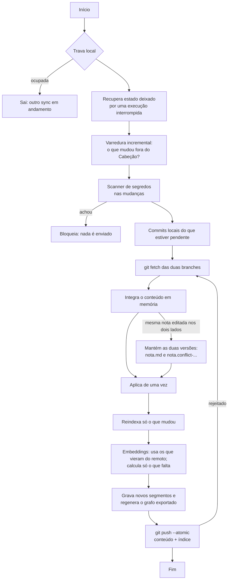

# 04 · Sincronização

> **Requisito:** nada é descartado. Conteúdo, embeddings e grafo sincronizam por git com **qualquer remoto**, e uma máquina nunca recalcula o que outra já calculou.

O desenho abaixo passou em 170 de 170 verificações, em 13 cenários, contra um remoto simulado em pasta local. Provedores reais ainda não foram testados; ver "O que falta validar".

## O que é sincronizado e como

| Dado | Onde fica | Como sincroniza |
|---|---|---|
| Notas (`raw/`, `wiki/`, `memory/`) | Branch principal | git comum |
| Conhecimento escrito pelo agente (relações, fatos, resumos) | Branch principal, dentro das notas | git comum |
| `log.md` | Branch principal | git, com merge por união (`.gitattributes`) |
| `index.md` | Branch principal | Regenerado depois de integrar; converge sozinho |
| Embeddings | Branch `cabecao/index`, em segmentos imutáveis | git, sem conflito por construção |
| Grafo exportado (`nodes.jsonl`, `edges.jsonl`) | Branch `cabecao/index` | Regenerado depois de integrar; idêntico byte a byte em todas as máquinas |
| Banco de consulta (SQLite) | `.cabecao/` local | Não vai para o git; é montado em segundos a partir do resto |

## Decisões que vieram dos testes

| Decisão | Motivo medido |
|---|---|
| A branch de índice é lida e escrita direto no banco de objetos do git, **sem** `git worktree` | O worktree quebrava ao mover o vault, ao apagar `.cabecao/` e em clones parciais |
| A integração é calculada em memória (`git merge-tree --write-tree`) e aplicada de uma vez (`git reset --keep`) | Não existe rebase "pela metade" para sobrar se o processo morrer |
| Conteúdo e índice sobem no **mesmo** `git push --atomic` | Enviando separado, um teste de carga calculou 2.789 embeddings para 1.477 trechos. Com envio único: 1.536 para 1.535 |
| O histórico do índice é reduzido por **gerações** (`cabecao/index` → `cabecao/index-1` → ...), sem reescrever histórico | Funciona em servidor que proíbe reescrita e exclusão de branch |

## O algoritmo de `cabecao sync`

### Tempos medidos (remoto local, sem rede)
- Nada mudou: 0,5 a 0,7 s.
- Cinco notas alteradas: 1,1 a 1,8 s, mais o cálculo dos embeddings novos.

### Quando roda
- No fim de cada sessão do Claude Code (hook, em processo separado).
- Pelo agendador do sistema, se você ativar (`cabecao schedule on`).
- Quando você ou o agente pedem (`cabecao sync`, tool `sync`).

## Instalação só com a URL

`cabecao init <url>` clona e decide pelo que encontra:

| Caso | Comportamento |
|---|---|
| Remoto vazio, sem commits | Cria a estrutura, o primeiro commit e a branch de índice, e envia |
| Remoto com um cérebro Cabeção | Clona, baixa a branch de índice e monta o banco **sem calcular nenhum embedding** |
| Remoto com vault de Obsidian ou Markdown comum | Adota: acrescenta `.cabecao.json`, não move nada e indexa |
| Remoto com outra coisa (código, por exemplo) | Recusa e explica |
| URL inválida, sem permissão ou sem rede | Mensagem clara; oferece começar só local e ligar o remoto depois |

O nome da branch principal é o que o remoto usar (`main`, `master`, `trunk`); nada é assumido.

## Conflitos

- **Mesma nota editada em duas máquinas:** nada é resolvido em silêncio e nada se perde. `nota.md` fica com a versão remota, e a sua versão local vira `nota.conflict-<máquina>-<data>.md` ao lado. A tool `status` e o painel de saúde no Obsidian listam os conflitos. Você resolve e apaga o arquivo extra.
- **Edições em regiões diferentes da nota:** são mescladas automaticamente.
- **Linhas vizinhas do frontmatter** editadas em máquinas diferentes: contam como conflito e geram a cópia.
- **Arquivo editado durante o sync:** não é sobrescrito.

## Processo morto no meio

Testado com 74 mortes forçadas, em pontos fixos e aleatórios. Em todas, o sync seguinte se recuperou sozinho e nenhuma nota foi perdida. Segmentos incompletos são descartados pelo checksum.

## Autenticação

O Cabeção usa o git que você já usa: chave SSH, token salvo, gerenciador de credenciais. Como o sync roda sem terminal, ele nunca pode ficar parado pedindo senha:

- `GIT_TERMINAL_PROMPT=0`, `GIT_ASKPASS` e `SSH_ASKPASS` neutros, `ssh -o BatchMode=yes` e tempo limite.
- Credencial ausente vira um erro claro em cerca de 50 ms (medido em HTTPS).

## Crescimento do repositório

Simulação de 180 dias com 2.000 notas e vetores de 768 dimensões:

| | Tamanho |
|---|---|
| Dados em uso | 7,8 MB |
| Repositório sem redução de histórico | 57,7 MB |
| Com gerações, depois da limpeza do servidor | 7,8 MB |

- `cabecao compact` junta segmentos, remove vetores de trechos que não existem mais e inicia uma geração nova.
- A liberação de espaço no remoto depende de o provedor rodar a limpeza interna dele. Sem ela, o índice cresce cerca de 8 MB por mês nesse ritmo de uso.

## Convivência com outros clientes git

- **Obsidian Git, linha de comando, celular:** podem fazer commit e pull na branch principal. O próximo sync detecta e reindexa só a diferença.
- Todo clone comum também baixa a branch de índice (alguns megabytes). É o custo de usar uma branch normal, que funciona em qualquer provedor.

## O que falta validar

- Provedores reais: GitHub, GitLab, Bitbucket e Gitea. O comportamento deles neste plano vem de documentação.
- `git push --atomic` em servidor sem suporte (há um caminho alternativo no desenho, pouco exercitado).
- Falha de chave SSH e gerenciadores de credencial reais.
- Commits assinados (`commit.gpgsign`): podem pedir senha num processo sem terminal.
- Windows e Linux, latência de rede real e vaults acima de 2.000 notas no sync.
- Vetores calculados em máquinas de arquiteturas diferentes diferem levemente (semelhança de 99,4% a 99,8%). Vale o primeiro que chegar. Falta medir a busca com vetores de origens misturadas.
