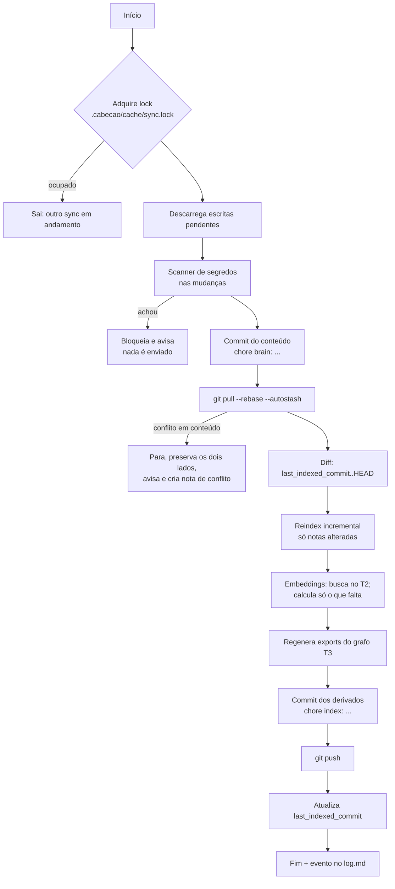

# 04 · Sincronização

> **Requisito:** nada é descartado. Índices, embeddings e grafo **viajam junto** com o conteúdo. Ao sincronizar, cada máquina **só calcula o que falta**.

## As 5 camadas de dados

| Camada | O que é | Exemplo | Onde fica | Sincroniza? | Como |
|---|---|---|---|---|---|
| **T0 · Conteúdo** | Escrito por você ou pela IA | `raw/`, `wiki/`, `memory/` | git | ✅ | commit/pull/push |
| **T1 · Conhecimento extraído** | Saída cara de LLM | entidades, relações tipadas, fatos temporais, resumos de comunidades | **Markdown** em `wiki/` e `memory/facts/` | ✅ | igual a T0 (é conteúdo) |
| **T2 · Derivado caro** | Computação pesada e determinística | **embeddings** | `.cabecao/embeddings/` | ✅ | git |
| **T3 · Derivado exportável** | Estruturas para reconstrução rápida e uso externo | `nodes.jsonl`, `edges.jsonl`, `communities.jsonl`, `manifest.json` | `.cabecao/graph/` | ✅ | git |
| **T4 · Índice materializado** | Banco pronto para consulta | `cabecao.db` (FTS5 + vec0 + tabelas de grafo) | `.cabecao/cache/` | 📦 snapshot | reconstrução **incremental** a partir de T0–T3 + **snapshot opcional** |

Com T0–T3 no git, reconstruir o T4 numa máquina nova leva **segundos**, porque nenhum embedding é recalculado. Para cérebros grandes, o **snapshot** do T4 elimina até esses segundos.

## Armazenamento de embeddings (T2)

Requisitos: ser amigável ao git, mesclável sem conflito, compacto e endereçado por conteúdo.

```
.cabecao/embeddings/
└── multilingual-e5-small@onnx-q8/
    ├── meta.json            ← { model, dims, dtype: "f16", normalize: true }
    ├── 00.jsonl
    ├── 01.jsonl
    ├── ...                  ← 256 shards pelo prefixo hex da embedding_key
    └── ff.jsonl
```

Cada linha:
```json
{"k":"9f2c…e1","v":"<base64 de float16[384]>"}
```

- **Append-only:** novas chaves são **acrescentadas** e nada é editado no lugar.
- **`merge=union`** no `.gitattributes`: duas máquinas que acrescentaram linhas no mesmo shard são mescladas **automaticamente** pelo git, sem conflito.
- **Duplicatas são inofensivas:** a mesma chave produz o mesmo vetor. `cabecao compact` deduplica e remove chaves órfãs (trechos que não existem mais), num commit próprio.
- **Vários modelos convivem:** cada modelo tem a sua pasta. Trocar de modelo dispara a re-geração em segundo plano (uma Task), e o modelo antigo continua ativo até a troca terminar.
- **Tamanho:** 384 dims × 2 bytes ≈ 0,75 KB por trecho (≈ 1,1 KB com base64 e chave). Com 20 mil trechos, ~22 MB no diretório de trabalho.
- **Sem Git LFS:** o LFS troca os arquivos por ponteiros, e aí o `merge=union` deixa de funcionar. As duas coisas são incompatíveis.

### Custos conhecidos desta escolha
- **O histórico do git cresce.** Vetores em base64 quase não comprimem entre versões, e cada `compact` reescreve shards. Mitigações: `compact` roda pouco (ex.: mensal) e num commit só; o crescimento será medido no spike do M0 ([roadmap](10-roadmap.md)). Se for alto demais, o plano B é guardar os embeddings numa branch órfã com histórico achatado.
- **Vetores podem diferir em bits** entre máquinas (hardware diferente). Para a mesma chave, vale a primeira linha encontrada; a diferença é irrelevante para a busca.
- **Os *merge drivers* ficam na configuração local do git**, não no repositório. Um clone feito sem `cabecao init` (ou um cliente git no celular) cai no merge de texto padrão: nos embeddings ainda funciona (`union` é nativo do git), mas os exports do grafo podem conflitar. `cabecao doctor` detecta e corrige.

## Grafo exportado (T3)

`nodes.jsonl`, `edges.jsonl` e `communities.jsonl`, **ordenados de forma determinística**. Eles servem para:
- reconstruir o T4 sem reprocessar o Markdown inteiro;
- ferramentas externas (Gephi, Cosmograph, scripts) e o MCP App do grafo;
- *diff* legível do que mudou no grafo em cada commit.

Como são **derivados determinísticos** de T0/T1, um conflito de merge nesses arquivos se resolve **regerando**. O `cabecao init` instala o *merge driver* `cabecao-regen`:

```gitattributes
.cabecao/embeddings/**/*.jsonl  merge=union  -diff
.cabecao/graph/*.jsonl          merge=cabecao-regen
.cabecao/manifest.json          merge=cabecao-regen
```

## Snapshot do índice (T4)

SQLite binário **não** vai para o histórico do git (geraria um *blob* novo a cada mudança). Em vez disso:

| Opção | Como | Quando usar |
|---|---|---|
| **Reconstrução incremental** (padrão) | `cabecao reindex --incremental` a partir de T0–T3 | Sempre; é rápido porque os embeddings vêm do T2 |
| **Snapshot local** | `cabecao snapshot` → `.cabecao/cache/snapshots/<commit>.db.zst` | Backup antes de migrações |
| **Snapshot remoto** | Asset numa *GitHub Release* privada do repo do cérebro, marcado com o SHA do commit | Máquina nova + cérebro grande: baixa o snapshot e aplica só o *delta* desde aquele commit |

## O algoritmo de `cabecao sync`



### Quando o sync roda
- **Periódico** no daemon (padrão: a cada 10 min se houver mudanças, configurável);
- no **fim de sessão** (hook do Claude Code);
- **sob demanda** (tool MCP `sync`, CLI `cabecao sync`);
- ao **iniciar** o daemon (*pull* para pegar o que veio de outras máquinas).

### Conflitos de conteúdo
- Conflitos em Markdown **nunca** são resolvidos em silêncio.
- O Cabeção preserva as duas versões (`nota.md` e `nota.conflict-<maquina>-<data>.md`), registra em `log.md`, marca a nota com `conflict: true` e avisa pela tool `status`.
- Você resolve no Obsidian. O próximo sync detecta a resolução.

### Várias máquinas
- Cada máquina tem um `machine_id` em `~/.config/cabecao/machine.json`, que **não** vai para o repo.
- `origin` e o log registram de qual máquina e de qual agente veio cada mudança.

### Convivência com o plugin Obsidian Git
Só pode haver **um dono do sync**. Recomendação:
- **Com o daemon do Cabeção:** desative *auto pull/push* no Obsidian Git (ou nem instale o plugin).
- **Sem o daemon:** o Obsidian Git pode fazer commit/push, e o Cabeção roda `reindex --incremental` ao iniciar.

## Modo sem GitHub

Tudo funciona com um repositório **apenas local**. Para sincronizar entre máquinas sem GitHub, use qualquer *remote* git (outro servidor, pasta em disco externo, Gitea). O Cabeção só exige um *remote* git, não especificamente o GitHub.
