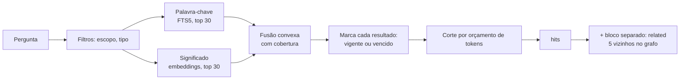

# 06 · Busca e grafo

> **Estado (marco 1):** existe a busca **por palavra-chave** (FTS5): os termos são combinados com `AND` e, se não houver resultado, com `OR`; palavras vazias são removidas; cada resultado é marcado como vigente ou vencido e o vencido é rebaixado. Cópias de conflito do sync ficam fora de `recall` e `search`. **Não existem ainda**, e são planos: embeddings e fusão com a busca por significado (marco 2); `as_of`, o bloco `related`, as tools `graph`, `facts` e `relate`, relações tipadas e menções (marco 3). O restante deste documento descreve o desenho completo.

> **É só uma wiki ou é um GraphRAG?** É uma **wiki com grafo**. O grafo existe e é útil, mas quem navega por ele é o agente. O pipeline completo de GraphRAG (extração de entidades por LLM, relatórios de comunidade, PageRank no ranking) foi medido e não se pagou.

## Busca híbrida



### Palavra-chave
- FTS5 do SQLite, com remoção de acentos, sobre o texto e o título.
- A pergunta é limpa de palavras vazias ("de", "que", "para"...), o que derrubou uma busca longa de 280–520 ms para 14 ms.
- Sozinha, acerta 95% das buscas por termo exato (IDs, nomes de função, códigos de erro) e 0% das paráfrases.

### Significado
- **Modelo:** você escolhe ao ativar a busca por significado; ver "Escolha do modelo" abaixo. Ele roda na sua máquina.
- **Contexto no trecho:** cada trecho é embutido com o prefixo `Título › Seção`. Isso levou o acerto de 0,825 para 0,872, e de 17–33% para 75–92% nas perguntas que dependem do título.
- **Trechos:** divisão por seções do Markdown, com cerca de 350 tokens.
- **Busca:** força bruta em JavaScript; 100 mil vetores em 31 a 70 ms.

### Fusão

```
score = α · minmax(cosseno) + (1 − α) · min(1, bm25 / Σ idf dos termos da pergunta)      α = 0,5
```

A fusão usual (RRF) **piorou** o resultado: o acerto em paráfrases caiu de 67% para 15%, porque um trecho que casava por uma palavra solta aparecia nas duas listas e passava na frente. A fusão acima manteve o ganho dos dois lados.

| Conjunto de teste | Só vetor | RRF | Fusão adotada |
|---|---|---|---|
| Sintético em português (MRR) | 0,872 | 0,708 | 0,857 |
| Belebele (MRR) | 0,935 | 0,928 | 0,952 |
| Quati (nDCG@10) | 0,583 | 0,564 | 0,580 |

### Escolha do modelo

O Cabeção **não impõe um modelo**. Quem instala escolhe, e o projeto documenta sugestões testadas. O Cabeção não redistribui nenhum modelo: ele é baixado do Hugging Face na sua máquina, sob a licença do próprio modelo.

```bash
cabecao embeddings on                       # mostra as sugestões e pergunta
cabecao embeddings on embeddinggemma-300m   # escolhe direto
```

A escolha é gravada no `.cabecao.json` do cérebro. As outras máquinas usam o mesmo modelo sem perguntar de novo, porque os vetores sincronizados só servem para o modelo que os gerou.

#### Sugestões testadas

Treze modelos foram medidos em português. Estes têm configuração pronta:

| Nome | Tamanho | Acerto no sintético (MRR) | Paráfrases certas | Licença | Indicado para |
|---|---|---|---|---|---|
| `embeddinggemma-300m` | 197 MB | **0,872** | **67%** | Gemma Terms of Use | Melhor qualidade em português |
| `bge-m3` | 570 MB | 0,836 | 48% | MIT | Boa qualidade com licença aberta, se o tamanho não incomodar |
| `embeddinggemma-2` | 175 MB | 0,802 | 40% | Apache-2.0 | Licença aberta e modelo leve |
| `multilingual-e5-base` | 279 MB | 0,763 | 40% | MIT | Alternativa aberta de tamanho médio |
| `multilingual-e5-small` | 118 MB | 0,693 | 17% | MIT | Máquinas fracas; depende muito da busca por palavra-chave |

- Nenhum modelo maior superou o primeiro da lista.
- Um modelo pequeno com palavra-chave não alcança o melhor (0,699 contra 0,857).
- A licença "Gemma Terms of Use" não é uma licença de código aberto reconhecida; leia os termos antes de escolher esse modelo.

#### Modelo próprio

Qualquer modelo ONNX do Hugging Face pode ser usado, declarando no `.cabecao.json` o repositório, o arquivo, as dimensões, o tipo de agregação e os prefixos de pergunta e de trecho. Modelos fora da lista não foram medidos; rode `cabecao eval` para comparar.

#### Trocar de modelo

`cabecao embeddings switch <nome>` recalcula tudo numa pasta nova da branch de índice. O modelo antigo continua em uso até a troca terminar.

### Reranker
Fora do padrão. O `bge-reranker-v2-m3` (571 MB) não melhorou o melhor modelo e levou cerca de 8,5 s para reordenar 30 candidatos. Um reranker pequeno piorou o resultado.

### Runtime de embeddings
- O núcleo não tem nenhuma dependência de aprendizado de máquina; a busca por palavra-chave funciona logo após instalar.
- `cabecao embeddings on` baixa o runtime (`onnxruntime-node` + tokenizador) e o modelo para o diretório de dados do usuário. Testado em 15 combinações de sistema e versão de Node.
- No Linux Alpine, o runtime nativo não carrega; o caminho alternativo em WebAssembly funciona, de 3 a 10 vezes mais lento.

## Validade no tempo

Foi o recurso que mais rendeu na medição.

- `search` e `facts` aceitam `as_of` (uma data). O padrão é hoje.
- Cada resultado vem marcado como **vigente** ou **vencido**. Resultados vencidos são rebaixados, **nunca escondidos**.
- `as_of` precisa ser um parâmetro: fixá-lo em "hoje" zerou as perguntas sobre o passado.
- Efeito medido: a versão vencida aparecia acima da correta em 50–70% dos casos; com o filtro, 0%.

## Grafo

### De onde vêm as arestas

| Origem | Como é criada | Usa LLM? |
|---|---|---|
| `wikilink` | `[[Nota]]` no texto | Não |
| `relation` | Propriedades de relação no frontmatter (`uses`, `part_of`...) | O agente escreve ao gravar a nota |
| `fact` | Sujeito e objeto das notas de fato | O agente escreve |
| `supersedes` | Decisão ou fato novo substituindo o antigo | O agente escreve |
| `mention` | Título ou apelido de outra nota citado sem link | Não (dicionário; precisão de 0,94 no teste) |

Tudo é reconstruível a partir do Markdown. Relações escritas pelo agente custam cerca de 56 tokens por nota.

### Como é usado

| Uso | Resultado na medição |
|---|---|
| Tool `graph`: o agente pede os vizinhos de uma nota, por tipo | O caminho completo até a resposta existe no grafo em 93% das perguntas de vários saltos (54% só com wikilinks) |
| Bloco `related` na busca: 5 vizinhos dos melhores resultados, **separado** do ranking | Acerto em perguntas de vários saltos sobe de 54% para 61–68%, sem prejudicar as outras |
| `lint` sugere transformar menções em links | — |

Misturar o grafo no ranking principal foi testado e descartado: derrubou a busca por termo exato de 83% para 72–78%.

### O que não entra

| Item | Motivo |
|---|---|
| Extração de entidades por LLM em cada trecho | Parte mais cara do GraphRAG; o servidor não tem LLM |
| Relatórios de comunidade automáticos | Gerados sem LLM, pioraram as respostas (cobertura de 0,21) |
| Arestas por semelhança de embedding | Não ajudaram |
| PageRank no ranking | Derrubou as perguntas temporais |
| Banco de grafos | SQLite resolve em milissegundos com 100 mil arestas |

### Resumos por tema (depois)
Resumos escritos por um agente ajudaram em perguntas globais (cobertura de 0,81 contra 0,61). Entram como notas comuns em `wiki/syntheses/`, escritas numa rotina de consolidação. Não são pré-requisito de nada.

## Limites desta medição

- Os conjuntos sintéticos foram escritos pelos próprios agentes que rodaram os testes. Valem como ordem de grandeza.
- O Quati (português nativo) foi usado só em parte e em 6 modelos.
- A navegação do agente pelo grafo foi simulada, sem um LLM respondendo.
- Falta medir com um cérebro real. O comando `cabecao eval` existe para isso: você escreve perguntas com gabarito e ele mede a busca no seu acervo.
