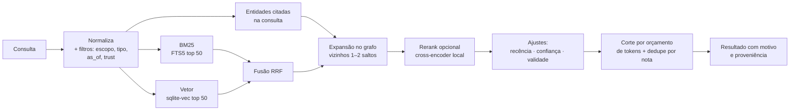

# 06 · Busca e grafo

## Pipeline de recuperação

### Etapas
1. **Filtros antes da busca:** escopo, tipo, `as_of` (ignora fatos fora da validade), `superseded_by` vazio e nível mínimo de confiança.
2. **BM25 (FTS5):** termos exatos (nomes, códigos de erro, IDs), com `unicode61 remove_diacritics` para o português.
3. **Vetor (sqlite-vec):** similaridade de cosseno com embeddings multilíngues.
4. **RRF (*Reciprocal Rank Fusion*):** `score = Σ 1/(k + rank_i)`, com `k = 60`.
5. **Expansão no grafo:** inclui vizinhos fortes dos melhores resultados (wikilinks, relações e fatos), com peso decrescente por salto.
6. **Rerank (opcional):** um *cross-encoder* local reordena os ~30 primeiros.
7. **Ajustes finais:** bônus para **recência** (`confirmed`/`updated`), **confiança** (`trust`) e notas do tipo `rule`/`decision` quando a consulta pede orientação.
8. **Orçamento:** junta trechos até `budget_tokens`, no máximo N trechos por nota, sempre com cabeçalho de proveniência.

### Chunking
- Quebra por **cabeçalhos Markdown** (seções), depois por parágrafos, com alvo de ~350 tokens e 15% de sobreposição.
- **Contextual retrieval:** antes do embedding, cada trecho recebe um prefixo `Título › Seção › Subseção`. Resolve o problema do "ele aumentou 20%" (quem é "ele"?). Tipo, escopo e tags **não** entram no prefixo: são filtros, e mudá-los não deve recalcular vetores.
- `chunk_key` é o hash do texto **com** o prefixo. Mudar o título da nota recalcula os trechos dela; mover o arquivo ou mudar o frontmatter não recalcula nada (ver [03](03-modelo-de-dados.md)).
- Modelos da família E5 exigem os prefixos `query:` e `passage:`; isso faz parte do `embedding_spec`.

### Embeddings
| Provedor | Padrão? | Observação |
|---|---|---|
| `transformers.js` (ONNX, local) | ✅ | Zero instalação externa; modelo multilíngue pequeno (família *multilingual-e5*) |
| Ollama | opcional | Modelos maiores (ex.: `bge-m3`) se o Ollama estiver instalado |
| APIs (Voyage, OpenAI, etc.) | opcional | O texto sai da máquina, por isso exige *opt-in* explícito |

## Grafo de conhecimento

### Tipos de aresta
| Origem | Exemplo | Peso inicial |
|---|---|---|
| `wikilink` | `[[PostgreSQL]]` no corpo | 1.0 |
| `relation` | `relations: [{type: usa, target: "[[SQS]]"}]` | 1.5 |
| `fact` | `subject → predicate → object` em `memory/facts/` | 1.5, com validade |
| `supersedes` | decisão nova → decisão antiga | 0.5 (navegação histórica) |
| `inferred` | co-ocorrência forte ou similaridade alta (gerada, **nunca** escrita no Markdown sem aprovação) | 0.3 |

### Entidades
- Uma entidade é uma nota em `wiki/entities/` com `aliases` no frontmatter.
- A resolução de nomes ("Postgres", "PG", "PostgreSQL" → mesma entidade) usa aliases + similaridade, e **sugere** fusões no `lint`.

### Fatos temporais
- Consultas com `as_of` respondem "o que era verdade naquela data".
- Um fato novo que contradiz outro **não apaga** o antigo: o antigo ganha `valid_until` e `superseded_by`.

### Comunidades (estilo GraphRAG)
- Algoritmo de **Leiden** sobre o grafo ponderado, em níveis hierárquicos.
- Cada comunidade relevante ganha uma nota de resumo em `wiki/_communities/`, gerada pelo agente ou por um LLM local, com `trust: medium`.
- Uso: perguntas **globais** ("quais os grandes temas do meu cérebro?") com *map-reduce* sobre os resumos.
- Também viram **cores** no grafo do Obsidian e regiões no MCP App.

### Multi-salto (estilo HippoRAG)
- Para perguntas que ligam fatos distantes: as entidades da consulta viram sementes de um **Personalized PageRank** no grafo, e os nós "ponte" entram como candidatos.

## Avaliação

- **Conjunto de perguntas douradas** por cérebro (`.cabecao/eval/questions.yaml`) com respostas esperadas.
- `cabecao eval` mede *recall@k*, MRR e a taxa de citações corretas, comparando os modos (keyword, semantic, hybrid, hybrid+graph).
- Regressões de busca entram no CI do projeto com um vault de *fixtures*.
