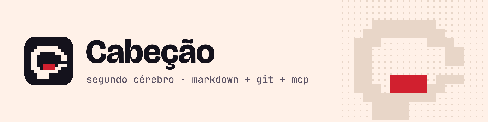

<p align="center">
  
</p>

# cabecao

Seu segundo cérebro em Markdown e git, para você e seus agentes de IA, servido por MCP.

Suas notas são arquivos Markdown num repositório git seu, em qualquer provedor (GitHub, GitLab, Bitbucket, Gitea, servidor próprio ou só a sua máquina). Os agentes de IA (Claude Code, Claude Desktop, Codex, Cursor, VS Code, Antigravity, Gemini CLI) consultam e gravam nelas pelo servidor MCP do `cabecao`. Cada gravação vira um commit que você desfaz com um comando.

> **Beta:** `0.1.0-beta.1`. Instale com a etiqueta `beta`.

*English: Cabeção is a personal second brain. Your notes are Markdown files in a git repository you own, on any host, and AI agents read and write them through a local MCP server. Every write is a commit you can undo. The CLI prints its messages in Portuguese for now. Documentation in English: <https://renanloureiroo.github.io/cabecao/en/>.*

## Começar

Requer Node.js 22.16+ (recomendado: 24) e git 2.38+. Crie antes um repositório vazio e **privado**.

```bash
npm i -g cabecao@beta
cabecao init git@github.com:voce/cerebro.git
cabecao doctor
```

O `init` não pergunta nada: cria o cérebro num repositório vazio, só baixa um cérebro existente (segunda máquina), adota um vault do Obsidian sem mover arquivos, recusa o que não é cérebro e, sem URL, cria um cérebro só local. Depois ele monta o índice local e registra o servidor MCP nos clientes de IA que encontrar.

## Comandos

| Comando | O que faz |
| --- | --- |
| `cabecao init [url]` | Instala ou conecta esta máquina a um cérebro |
| `cabecao status` | Notas, último sync, envios pendentes e conflitos |
| `cabecao doctor` | Diagnóstico com a correção sugerida para cada problema |
| `cabecao sync` | Sincroniza com o remoto, sem descartar nada |
| `cabecao search "<pergunta>"` | Busca por palavra-chave, com `--as-of` para o passado |
| `cabecao graph "<nota>"` | Vizinhos de uma nota no grafo |
| `cabecao facts` | Fatos e se valem numa data |
| `cabecao undo` | Desfaz uma operação ou uma sessão de agente |
| `cabecao ask "<pergunta>"` | Resposta com citações conferidas, pelo provedor que você ativar (opcional) |
| `cabecao llm on\|off\|status\|test\|remove` | O provedor das respostas do `ask`: desligado por padrão; nada sai da máquina até você ativar |
| `cabecao install-client <cliente>` | Registra o servidor MCP num cliente de IA |
| `cabecao mcp` | O servidor MCP por stdio, que os clientes iniciam |

`cabecao <comando> --help` mostra as opções. Todos aceitam `--json` e `--brain <pasta>`.

## Documentação

<https://renanloureiroo.github.io/cabecao/>: instalação, conceitos, guias, referência da CLI e das 12 tools MCP, segurança e solução de problemas.

Código e issues: <https://github.com/renanloureiroo/cabecao>

## Licença

[MIT](https://github.com/renanloureiroo/cabecao/blob/main/LICENSE)
